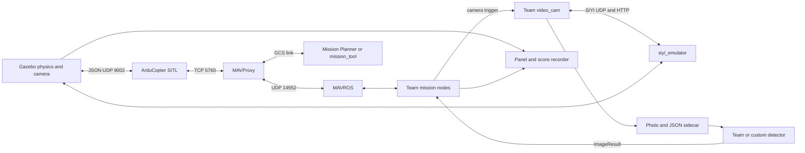

<!-- PURPOSE: describe the digital twin's processes, interfaces, start order, mission flow and source locations so a teammate can change one component and verify it. -->

# How the digital twin works

The real Jetson stack talks MAVLink to a Pixhawk and SIYI SDK/HTTP to a camera. The simulator supplies
those endpoints with ArduCopter SITL and `siyi_emulator`. Gazebo supplies motion, camera rendering and
payload physics. The team launch remains the reference for the mission nodes; the simulator wrapper
selects laptop model settings and can replace a component through a [profile](PLUGINS.md).

## Processes and source ownership

| Component | Source | Responsibility |
|---|---|---|
| Launch and ground tools | `ros2_ws/src/simulation/sim_bringup/` | Start order, SITL/MAVProxy, ROS bridges, mission upload, readiness and phases |
| Drone and payloads | `ros2_ws/src/simulation/sim_models/` | Iris/gimbal/cameras, SITL defaults, payload detach and landing events |
| Generated worlds | `ros2_ws/src/simulation/sim_worlds/` | World/config/mission/truth generation and validation |
| Camera emulator | `ros2_ws/src/simulation/siyi_emulator/` | SIYI SDK + media API, triggered Gazebo photos and camera state |
| Panel and scoring | `ros2_ws/src/simulation/sim_demo/` | Operator display, run evidence, truth detector, score report, reset logic |
| Profiles and contracts | `ros2_ws/src/simulation/sim_plugins/` | Resolve settings, wire replacements and check their interfaces |
| Example adapters | `ros2_ws/src/simulation/sim_plugin_examples/` | Copyable detector and listener templates |
| Human entry scripts | `simulation/scripts/`, `simulation/setup/` | Install/build/run/stop recipes around the packages |

The team's packages live directly under `ros2_ws/src/`: `main`, `video_cam`, `detection`, `mapping`,
`waypoint_mavros`, `wp_sender`, `gps_ros2`, `interfaces`. Read their READMEs before changing flight behavior.
The drone itself uses `launcher.sh`; `TRACKER_CMD` selects the simulation launch wrapper when requested.

## One automatic run

1. `demo.sh` resolves settings, archives old photos and starts `sim.launch.py` in a recorded session.
2. Gazebo loads the world and spawns the drone. The ArduPilot plugin is ready before SITL starts.
3. SITL and MAVProxy connect; the bridge, emulator and score recorder start. GUI tools are optional.
4. `mission_tool` waits for GPS/EKF/pre-arm readiness and uploads the survey.
5. `launcher.sh sim` starts MAVROS and `team_stack.launch.py`. `stack_check` waits for the team nodes,
   mission indices and detector readiness. There is one startup retry if the stack fails readiness.
6. The demo arms and starts AUTO. `phase_monitor` records progress until the vehicle lands.
7. The recorder writes Markdown/JSON scores. The demo copies photos and detections into the run folder,
   then stops its processes, unless `--keep` or manual mode keeps the session open.

`demo.sh --manual` leaves upload/arming/start to the operator. `start_sim.sh` starts only the simulator;
the team stack and ground tools then run in their own terminals. See [MISSION_PLANNER](MISSION_PLANNER.md).

## Mission behavior

The survey contains HOME, TAKEOFF, lane waypoints, a `DO_DIGICAM_CONTROL` item, a final hold point and RTL.
When ArduPilot emits `Mission: <n> DigiCamCtrl`, `mapping/trigger` starts 1 Hz camera requests and the
focus loop. `waypoint_manager` publishes mission indices and refreshes its copy after upload/arming.

`video_cam` queues requests, takes a photo through SIYI UDP, polls the camera's media API, and saves
`<lat> , <lon>.jpg` with a JSON sidecar. `new_od` processes every photo and publishes an `ImageResult`.
The controller keeps the highest-confidence person and tent, holds after the survey while processing
finishes, projects the best detection boxes to ground coordinates, inserts target waypoints, drops via
servos 13/11, and commands RTL. The real-airframe calibration and terrain limits are in
[WHAT_CHANGED](WHAT_CHANGED.md); a successful flat-world simulation does not close those decisions.

## Interfaces to keep stable

| Interface | Type or protocol | Producer → consumer |
|---|---|---|
| `/camera/trigger` | `std_msgs/msg/Bool`, true | trigger/panel → video_cam |
| `/camera/command` | `std_msgs/msg/String` | trigger/panel → video_cam |
| Camera control | SIYI SDK UDP `192.168.144.25:37260` | video_cam → emulator |
| Camera media | HTTP `192.168.144.25:82` | video_cam → emulator |
| Photo directory | `ros2_ws/src/video_cam/mapping_photos/` | video_cam → detector/controller |
| Photo metadata | `astra.photo_metadata.v1` JSON, matching stem | video_cam → aiming/scoring |
| `/image_detection` | `interfaces/msg/ImageResult`, reliable depth 10 | detector → controller/panel/score |
| `/mavros/mission/waypoints` | `mavros_msgs/msg/WaypointList` | MAVROS → mission nodes |
| `/mavros/mission/reached` | `mavros_msgs/msg/WaypointReached` | MAVROS → trigger/controller |
| `/addWaypoint` | `interfaces/srv/AddWaypoint` | controller → waypoint_manager |
| `/mavros/statustext/send` | `mavros_msgs/msg/StatusText` | team nodes → GCS/phase recorder |

The [slot contracts](PLUGINS.md#slot-contracts) specify exact custom-component obligations. Keep a custom
detector's class IDs `"0"`/`"1"`, full-photo pixel coordinates, exact file names and one result per photo,
including empty results. Do not run competing detectors or mission brains in one run.

## Ports and frames

| Endpoint | Default purpose |
|---|---|
| TCP `5760 + 10*I` | SITL serial0 → MAVProxy |
| TCP `5762 + 10*I`, `5763 + 10*I` | Spare SITL MAVLink links |
| UDP `9002 + 10*I` | Gazebo plugin ↔ SITL JSON physics |
| UDP `127.0.0.1:14550` | Ground tools inside Linux; one listener |
| UDP `127.0.0.1:14552` | MAVROS; `udp://:14552@localhost:14552` |
| UDP `127.0.0.1:14553` | Panel mission commands |
| UDP Windows host `14550` | Mission Planner under WSL NAT |

`I` is the SITL instance, normally 0. Mirrored WSL networking uses Windows port 14551 by default.
`ROS_DOMAIN_ID` must match between simulator and team stack. `GZ_PARTITION=astra_sim` keeps Gazebo
traffic in one partition. Derive endpoints with `sim_bringup/sim_paths.py`, rather than duplicating them.

Gazebo world/odometry uses east-north-up. Compass heading is degrees clockwise from north. The SIYI
raw yaw convention is left-positive; pitch `-90` means down. Photo pixels start at top-left, x right,
y down. Home in the world config, spherical coordinates and SITL must agree. A rotated photo or a new
camera FOV must update its metadata and projection tests together.

## Change one piece

For a recognition model or node, follow [PLUGINS](PLUGINS.md). For another firmware binary or remote
SITL, use [ARDUPILOT](ARDUPILOT.md). For geometry, terrain, missions and answer keys, use
[WORLDS](WORLDS.md). For running on another PC, use [DOCKER](DOCKER.md).

Before changing code, identify its hardware-facing defaults and tests. Build through `03_build.sh`,
run the affected package tests, then run a headless mission if interfaces or runtime behavior changed.
Use one heavy job at a time. Update the matching guide, `AGENTS.md` and `docs/HANDOFF.md` with evidence.

## Evidence and limits

Runs live outside the checkout under `~/.astra_sim/runs/`; build logs are under `~/.astra_sim/logs/`.
`score_report.md` explains target detection, aim error, drop error, photo processing and phases;
`run_data.json` supports rescoring with `ros2 run sim_demo score_run --rescore RUN_DIRECTORY`.
Check whether the drop metric used actual payload landing or a release-position fallback.

The runway demo is the established integration case. Profiles, START OVER/manual flows, real terrain
and Docker have separate acceptance checks; consult [the handoff](../HANDOFF.md) for their current state.
