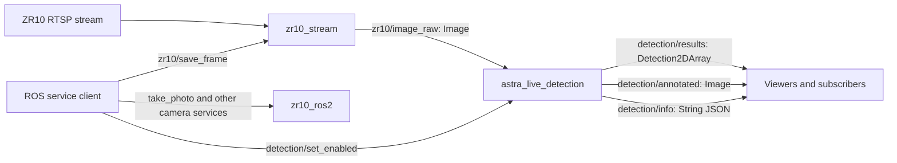

# Camera and detection over ROS 2

For a guided explanation of each source file and the successful manual
Jetson tests, see [CODE_WALKTHROUGH.md](CODE_WALKTHROUGH.md).

The ZR10 stream now feeds a live detection node through ROS messages. The
`astra_live_detection` node reuses the cloned repository's `model_manager`,
`detection_processor`, `annotation`, and `gpu_utils` modules. Those modules were
copied with their internal import prefix changed and trailing whitespace cleaned; `UPSTREAM.json` records
the source commit and hashes. The existing detector's classification/filtering
rules remain in use. No model training or accuracy evaluation was performed.

The original `detection` package's folder-based executables remain available.
The new live executable avoids their disk-polling stage and their undeclared
`ultralytics_ros/ImageResult` dependency. It uses standard `vision_msgs` results.



## Build on the ROS machine

Use the existing ROS installation on the Jetson. From the repository's
`ros2_ws` directory, after adding the three supplied packages under `src/`:

```bash
source /opt/ros/humble/setup.bash
rosdep install --from-paths src/zr10_stream src/astra_live_detection --ignore-src -r -y
colcon build --packages-select zr10_stream astra_live_detection --symlink-install
source install/setup.bash
```

The inference Python environment also needs SAHI, Ultralytics and a compatible
PyTorch installation. Use the Jetson environment already used by the original
detector; keep its JetPack/CUDA-compatible PyTorch. These model dependencies are
not installed or upgraded by this change. Check them with:

```bash
python3 -c 'import rclpy, cv_bridge, torch, sahi, ultralytics; print("imports OK")'
```

Start camera streaming and detection together, using the repository's existing
weights (no weights download or TensorRT conversion is triggered by the adapter):

```bash
ros2 launch astra_live_detection camera_detection.launch.py \
  model_path:="$(pwd)/src/detection/detection/yolo11s.pt" device:=cpu
```

For a verified CUDA-enabled environment, use `device:=cuda:0`. Existing TensorRT
`.engine` paths are supported by the upstream loader; that loader can fall back
to a sibling `.pt` and reports the fallback in its logs. A TensorRT engine must
match the target Jetson/runtime. The output model-format label follows the
requested extension; inspect loader logs to identify any fallback.

In the standalone supplied `astra_ws`, point `model_path` at the existing
repository's model file, or copy your approved model into that machine and use
its absolute path. Model weights are not duplicated in the integration ZIP.

Optional camera commands use the previously selected `zr10_ros2` node. Build
it separately, then add these launch arguments:

```bash
rosdep install --from-paths src/zr10_ros2 --ignore-src -r -y
colcon build --packages-select zr10_ros2 --symlink-install
source install/setup.bash
ros2 launch astra_live_detection camera_detection.launch.py \
  model_path:="$(pwd)/src/detection/detection/yolo11s.pt" \
  start_camera_control:=true dry_run:=false
```

`dry_run` defaults to true when camera control is enabled. The default launch
starts streaming and detection, with camera command control disabled. Do not
start another command controller against the same camera simultaneously.

## Topics

Names below assume the root ROS namespace. Images use a queue depth of one at
the publisher. The detector's best-effort sensor-data subscription accepts the
stream's reliable publisher and other best-effort camera publishers.

| Topic | Message | Publisher → subscriber |
| --- | --- | --- |
| `/zr10/image_raw` | `sensor_msgs/msg/Image` (`rgb8`) | Stream → live detector, image viewers |
| `/detection/results` | `vision_msgs/msg/Detection2DArray` | Live detector → result consumers |
| `/detection/annotated` | `sensor_msgs/msg/Image` (`bgr8`) | Live detector → image viewers |
| `/detection/info` | `std_msgs/msg/String` containing JSON | Live detector → monitoring/logging |

The results include bounding boxes, original YOLO class names and confidence
scores. JSON additionally includes the upstream person/tent/object category,
target flag and processing duration. An empty detection array means a completed
inference found no retained objects. Inference errors are reported in logs and
health/statistics; they do not produce fake empty successful results.

All three result topics retain the input image's header, including timestamps
and frame ID. For ZR10 stream frames the timestamp is host publication time,
not exposure time. Neither GPS coordinates nor camera calibration are invented.

The existing flight controller expects `/image_detection` with the custom
`ultralytics_ros/ImageResult` message and additional mission/location semantics.
It cannot consume `Detection2DArray` by simply remapping the topic. Connecting
that controller requires its actual custom message package and verified
geolocation/mission data; this camera/detector launch does not start it.

## Services

| Service | Type | Behavior |
| --- | --- | --- |
| `/detection/set_enabled` | `std_srvs/srv/SetBool` | Pause/resume inference input |
| `/detection/get_health` | `std_srvs/srv/Trigger` | JSON worker/input/error status; success requires input within five seconds and no current error |
| `/detection/get_statistics` | `std_srvs/srv/Trigger` | JSON received/replaced/processed/stale/error counters |
| `/zr10/save_frame` | `std_srvs/srv/Trigger` | Save a fresh streamed frame to PNG; return its path |
| `/take_photo` | `std_srvs/srv/Trigger` | Existing camera SD-card photo command, when camera control is running |
| `/autofocus`, `/toggle_recording`, `/stop_zoom`, `/stop_gimbal`, `/center_gimbal` | `std_srvs/srv/Trigger` | Existing camera commands, when camera control is running |

```bash
ros2 service call /detection/set_enabled std_srvs/srv/SetBool '{data: false}'
ros2 service call /detection/get_health std_srvs/srv/Trigger '{}'
ros2 service call /detection/get_statistics std_srvs/srv/Trigger '{}'
ros2 service call /detection/set_enabled std_srvs/srv/SetBool '{data: true}'
ros2 service call /zr10/save_frame std_srvs/srv/Trigger '{}'
```

Pausing clears pending/completed work and discards results from an already
running inference. It does not interrupt a GPU kernel or stop the camera stream.
Resume waits for new incoming frames. One inference runs at a time, with only
the latest pending input retained. Frames replaced under load are counted.
Pending frames older than `max_pending_age_sec` are dropped before inference;
this does not impose a timeout on running model inference. Shutdown waits for
running inference to return before destroying the ROS node.

The camera node also subscribes to `/zoom_direction` (`std_msgs/msg/Int8`,
-1/0/1) and `/gimbal_speed` (`geometry_msgs/msg/Vector3`, x=yaw, y=pitch).
Camera command success means UDP send success, not a hardware acknowledgment.
`/take_photo` captures on the SD card; `/zr10/save_frame` saves a stream snapshot.

## Existing publishers and other topic names

To subscribe to an already-running camera instead of starting the RTSP reader:

```bash
ros2 launch astra_live_detection camera_detection.launch.py \
  model_path:=/absolute/path/to/model.pt start_stream:=false image_topic:=/image_raw
```

The launch also accepts `rtsp_url`, `width`, `height`, `fps`, `snapshot_directory`,
`confidence_threshold`, `slice_height`, `slice_width`, `overlap`, `enabled`,
`max_pending_age_sec`, `camera_ip` and `dry_run`. These configure startup;
use `set_enabled` for runtime pause/resume. Changing resolution can affect small
object recall, so evaluate accuracy at the chosen settings on camera images.

## Inspect the pub/sub environment

Use the same ROS distribution, `ROS_DOMAIN_ID`, and reachable DDS network on
each machine. Source the workspace in every terminal.

```bash
ros2 node list
ros2 node info /astra_live_detection
ros2 topic info /zr10/image_raw --verbose
ros2 topic hz /zr10/image_raw
ros2 topic echo /detection/results
ros2 topic echo /detection/info
ros2 service list -t
ros2 run rqt_graph rqt_graph
ros2 run rqt_image_view rqt_image_view
```

Select `/detection/annotated` in the image viewer. Install the optional ROS
`rqt_graph` and `rqt_image_view` packages if those tools are absent.

## Validation

Eight camera-free tests passed on this Mac: four stream/PNG tests and four
inference-worker tests covering replacement under load, pause during in-flight
work, stale pending frames, error reporting/recovery and shutdown. All Python
files parse and package XML is valid.

The additional smoke test uses real ROS pub/sub, real services and actual SAHI
model inference on a synthetic image. It checks output headers, image encoding,
statistics, health and pause/resume:

```bash
ASTRA_TEST_MODEL="$(pwd)/src/detection/detection/yolo11s.pt" \
  python3 src/astra_live_detection/test/test_ros_pipeline.py
```

That automated test was skipped on this Mac because ROS 2, OpenCV and SAHI are
unavailable. It has not been reported as run on the Jetson. Subsequent manual
Jetson checks confirmed package build, model loading with CUDA requested, live
image delivery, published detections, health/statistics responses and a
successful snapshot save. The repeated walk-through produced person scores
around 0.92–0.95 during the central visible interval. These observations are not
a recognition accuracy benchmark. Visual box/image review, pause/resume and
stream recovery on hardware remain pending. See the walkthrough for the evidence
and the duplicate-launch issue that was resolved during testing.
