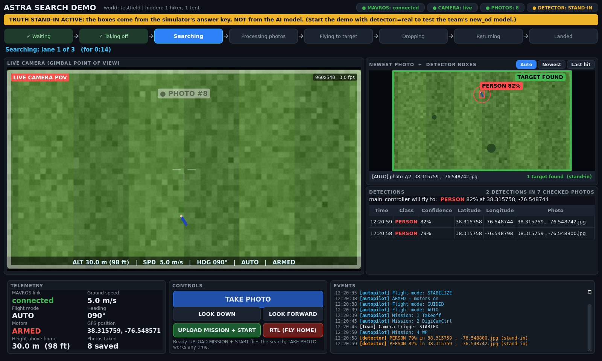
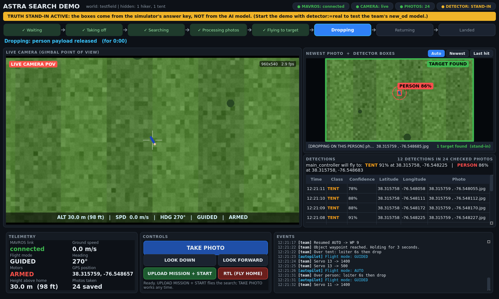
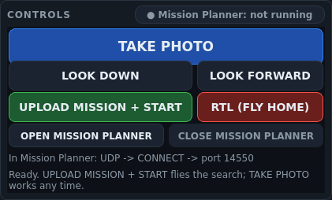

<!-- Purpose: explain the simulation panel, repeat-run controls, detector stand-in and mission score,
including their interfaces and the unit checks used before flying the simulator. -->
# sim_demo: what you WATCH during a simulated search

`sim_demo` is the part of the ASTRA simulator that people look at. It has four programs:

| Program | What it does, in one sentence |
|---|---|
| `demo_panel` | A window that shows the drone's camera live, the newest photo with the detector's boxes on it, the list of detections, which phase the mission is in, and big buttons. |
| `truth_detector` | An optional stand-in for the team's AI detector: it "finds" the hiker and the tent from the simulator's answer key, so the rest of the mission can be shown even if the AI misses simulated targets. |
| `demo_markers` | Draws the mission in RViz: search area, real targets, photo footprints, detections, the drone's path and the drop points. |
| `score_run` | Writes a report card after each flight: was each target found, how sure was the detector, how far off were the location and the payload drop. |



## Quick start (the short version)

You normally do not start these by hand: `simulation/scripts/demo.sh` starts everything.
To start only the demo tools next to a running simulator:

```bash
source ~/ODLC_Machine_Inferencing_System_2025-2026/simulation/setup/sim_env.sh
ros2 launch sim_demo demo_nodes.launch.py world:=runway              # panel + markers + scorer
ros2 launch sim_demo demo_nodes.launch.py world:=runway detector:=truth   # ... + the stand-in detector
```

What you should see: a dark window called **"ASTRA Simulation - Search Demo"**. Before the simulator
runs, every part says "waiting for ..." in grey. That is normal.

Each program also works alone, for example:

```bash
ros2 run sim_demo demo_panel --ros-args -p world:=runway
ros2 run sim_demo truth_detector --ros-args -p world:=suas_field
ros2 run sim_demo demo_markers --ros-args -p world:=runway -p frame_id:=world
ros2 run sim_demo score_run --ros-args -p world:=runway -p run_dir:=/tmp/my_run
ros2 run sim_demo score_run --rescore /tmp/my_run           # score a recorded run again, no ROS needed
```

## The demo panel



(These pictures come from the fake-mission test, which paints a simple world; with the real
simulator the live view and the photos show Gazebo.) Before anything runs, the panel looks
like [this](docs/panel_waiting.png).

From top to bottom:

1. **Status pills** (top right): MAVROS (connected to the autopilot?), CAMERA (live picture?),
   PHOTOS (how many this run), DETECTOR (REAL = the team's `new_od`, STAND-IN = `truth_detector`,
   red "TWO detectors!" if both run by mistake). An **amber banner** says so whenever the stand-in
   is the detector.
2. **Phase strip**: Waiting > Taking off > Searching (lane i of n) > Processing photos >
   Flying to target > Dropping > Returning > Landed. The lit box is now; ticked boxes are done.
   The line below explains the phase in words ("Searching: lane 2 of 3 (for 1:21)").
3. **Live camera** (big, left): the gimbal camera from Gazebo with height (m and ft), speed,
   heading, flight mode, armed state and camera tilt/zoom. It flashes white and says
   "PHOTO #n" every time a new photo lands in the team's photo folder.
4. **Newest photo + detector boxes** (top right). Three modes:
   * **Auto** (default): the newest photo; a photo with a target stays up for 8 s
     (`hit_hold_s`) so you can see it; while the drone flies to a target it shows the photo of
     the detection `main_controller` chose.
   * **Newest**: always the newest photo. **Last hit**: the last photo with a target.
   * Click a row in the detection list to pin that photo.
   Boxes come from the detector's `/image_detection` message for that photo (matched by file
   name): red = person (hiker), orange = tent, with the confidence. Tiny targets get a dashed
   ring so they stay visible. If the detector's message has no person/tent boxes but lists
   other things, the list is written on the photo instead, and the caption says so.
5. **Detections**: one row per box (time, class, confidence, latitude, longitude, photo), newest
   on top, and above it **what main_controller will fly to**: the highest-confidence person and
   tent, exactly the way the team's `main_controller.py` picks them.
6. **Telemetry**, **Controls** and **Events** (bottom). The Controls card:

   

   | Control | What it does |
   |---|---|
   | **TAKE PHOTO** | publishes `true` on the team's own `/camera/trigger` topic: `video_cam` then asks the camera (emulator) for a photo and downloads it, exactly like in flight. |
   | **LOOK DOWN / LOOK FORWARD** | send `gimbal_set_angles 0,-90` / `gimbal_set_angles 0,0` on `/camera/command` (the team's camera command protocol). |
   | **UPLOAD MISSION + START** | uploads the world's `.waypoints` mission, points the camera down, waits out the simulator's settling time (the first ~30 s "Arm: Gyros inconsistent" is normal), arms and starts AUTO. It talks MAVLink to MAVProxy's extra output `udp:127.0.0.1:14553`; if nothing answers there it uses MAVROS services instead. After the upload it asks MAVROS to re-read the mission so the team's `waypoint_manager` and `main_controller` see it. |
   | **RTL (FLY HOME)** | sends the drone home. |
   | **START OVER** | click twice within 5 seconds to land, reset the drone and both payloads, restart the autopilot and team stack, and create a new run folder while the windows stay open. Progress appears in Events; UPLOAD MISSION + START waits until the reset finishes. |
   | **OPEN MISSION PLANNER** | (Windows laptop only) starts Mission Planner, the team's ground-station program on Windows, so you can watch the simulated drone in it. It stays open when the panel closes. If it is already open, nothing happens (the panel says so). |
   | **CLOSE MISSION PLANNER** | asks Mission Planner to close, like clicking its X. If it is still open 5 s later, it is forced closed. Safe during a flight: the simulated autopilot has no ground-station failsafe. |
   | **● Mission Planner: running** (right of the CONTROLS title) | green = Mission Planner is open; grey = `not running` (or `not installed` / `not on Windows`); amber = `opening ...` / `closing ...`. It is checked every 2 s. |
   | **In Mission Planner: UDP -> CONNECT -> port 14550** | what to click in Mission Planner once it is open (step by step: `simulation/README.md`, "Watch it in Mission Planner"). |
   | status line (bottom of the card) | what the last button press did, in words (also written into the event log). |

   A Mission Planner button is grey when it cannot do anything right now: OPEN while Mission
   Planner is already open, CLOSE while it is closed, both while one of them is still working,
   and both when the panel does not run inside WSL on Windows (for example on the Jetson) or
   Mission Planner is not installed. Hold the mouse over a grey button to read why. OPEN starts
   `C:\Program Files (x86)\Mission Planner\MissionPlanner.exe` (or `C:\Program Files\...`); for
   another place set the parameter `mission_planner_exe` or the environment variable
   `MISSION_PLANNER_EXE`. The same from a terminal:
   `bash simulation/scripts/mission_planner.sh start|stop|status`.

   The event log shows the autopilot's texts (cyan), the team nodes' texts (white), camera
   replies (yellow), detections (orange) and the panel's own actions (green). Very frequent
   lines ("No objects detected.", "SUCCESS: Captured ...") are counted, not listed.

Nothing in the window ever waits for ROS or for Windows: ROS runs on a background thread, the
autopilot commands run on their own thread, and the Mission Planner checks and buttons on a
third one.

To reset and fly immediately from a terminal, run `bash simulation/scripts/start_over.sh --fly`.
Without `--fly`, press UPLOAD MISSION + START after the reset, or upload, arm and select AUTO in
Mission Planner. `demo.sh --manual` starts the simulator and team stack while leaving those flight
steps to the operator. These flows still need the live checks listed in `docs/HANDOFF.md` Task 3.

Reset stops only processes carrying the simulator's session tag. A manually started team stack in
the same ROS domain must be stopped in its own terminal first. A landing timeout or lost MAVLink
connection leaves the old drone in place and reports failure; restoring the link and landing safely
lets you try again. Recovery without a landing link is allowed when Gazebo confirms the drone is
already absent. A second reset cannot overwrite the running reset's progress, and reopening the
panel during a reset keeps its mission controls locked.

## How the stand-in detector works

`truth_detector` watches the same photo folder as the team's `new_od`
(`<ros2_ws>/src/video_cam/mapping_photos`, photo names `"<lat> , <lon>.jpg"`). For every photo:

1. It finds the camera pose at the moment the photo was taken: first from the camera
   emulator's own record (`/sim/camera/photo_info`: exact position, orientation, zoom, field
   of view), otherwise from the recorded MAVROS position/height/heading matched to the GPS in
   the file name, with the camera looking straight down.
2. It projects the true targets (from `sim_worlds/truth/<world>.yaml`) into the photo with a
   pinhole camera model and keeps those at least half inside the picture and at least
   12 px long.
3. It gives each a realistic confidence (smaller, cut-off or off-centre = less sure, plus a
   little noise; the same photo always gives the same numbers) and a slightly jittered box.
4. It publishes **the same message on the same topic as `new_od`**: `interfaces/ImageResult` on
   `/image_detection` (RELIABLE, depth 10), one per photo (also photos with nothing in them, and
   photos already in the folder at start, because `main_controller` waits until every photo
   was reported), `class_id` "0" = person / "1" = tent, `latitude/longitude` = the GPS in the
   file name (the drone's position, like `new_od`), `method` = "truth_detector (stand-in:
   answer key, not the AI model)". It also publishes `/sahi_detection_info` and answers
   `/sahi/get_statistics` and `/sahi/get_health` like `new_od`.

With `geolocation:=projected` it reports the target's own position instead (the box centre
projected to the ground, plus 0.5 m noise): that shows how much better the drops get with real
pixel-to-ground geolocation.

The test suite checks the messages against the **team's own** `main_controller.image_result_cb`
(see Tests): it accepts them and picks the right person and tent.

## The score report

`score_run` writes into its run folder (`run_dir`, default `$ASTRA_RUN_DIR` or
`~/astra_sim_runs/<world>_<time>`), when the drone has landed (or on Ctrl+C, or when you call
`ros2 service call /sim/demo/write_score std_srvs/srv/Trigger`):

* `score_report.md` - targets found, best confidence, in how many photos each target was
  detected / was visible, **aim error** (main_controller's `Aim <class> <lat>,<lon>` status
  text vs truth), **photo GPS error** (the old location error: detector's lat/lon vs truth), **drop error**
  (payload resting point in Gazebo, or the drone's position when the release servo opened,
  vs truth), what main_controller chose, per-photo precision/recall, false alarms, time line.
* `mission_map.png` - a top-down picture: search area, every photo's footprint, the drone's
  track, detections, what main_controller chose, where the payloads landed, and the real
  targets (linked at the top of the report).
* `score_report.json` - the same numbers for scripts.
* `run_data.json` - all inputs, so `score_run --rescore DIR` can recompute the report later.
* `events.jsonl` - everything that happened, one JSON object per line.

The JSON keeps `location_error_m` for older analysis scripts and adds `aim_error_m`. Without an
aim status text the aim error stays unknown. Re-scoring an older run searches `events.jsonl` for
those texts. The map's chosen-target rings use the aim position when available.

## RViz markers

`/sim/demo/markers` (`visualization_msgs/MarkerArray`, latched, 2 Hz) in frame `world`
(Gazebo world, x = east, y = north, origin = SITL home). Namespaces: `search_area` (yellow),
`targets` (hiker red, tent orange, labelled, true size), `footprints` (blue patches: ground
each photo covered, newest outlined), `detections` (spheres where the detector reported
targets), `best` (what main_controller flies to), `route` (mission from the autopilot),
`track` (where the drone flew), `drone` (arrow), `drops` (release points), `landed` (payload
resting points from Gazebo).

## Interfaces

### Topics and services

| Name | Type | Who | Direction | Notes |
|---|---|---|---|---|
| `/sim/camera/image` | sensor_msgs/Image | panel | in | live POV (bridged from Gazebo `/sim/camera/video/image`), BEST_EFFORT |
| `/image_detection` | interfaces/ImageResult | panel, markers, scorer | in | the detector's results (RELIABLE, depth 10) |
| `/image_detection` | interfaces/ImageResult | truth_detector | out | same message as `new_od` (RELIABLE, depth 10) |
| `/sahi_detection_info` | std_msgs/String | truth_detector | out | JSON summary per photo, like `new_od` |
| `/sahi/get_statistics`, `/sahi/get_health` | std_srvs/Trigger | truth_detector | service | like `new_od` |
| `/mavros/state` | mavros_msgs/State | all | in | armed, mode, connected |
| `/mavros/global_position/global` | sensor_msgs/NavSatFix | all | in | drone GPS (also the photo-pose history) |
| `/mavros/global_position/rel_alt` | std_msgs/Float64 | all | in | height above home [m] |
| `/mavros/global_position/compass_hdg` | std_msgs/Float64 | all | in | heading [deg] |
| `/mavros/vfr_hud` | mavros_msgs/VfrHud | all | in | ground speed, heading |
| `/mavros/local_position/pose` | geometry_msgs/PoseStamped | all | in | heading fallback |
| `/mavros/mission/reached` | mavros_msgs/WaypointReached | all | in | lane numbers, target arrival |
| `/mavros/mission/waypoints` | mavros_msgs/WaypointList | all | in | mission as the autopilot has it |
| `/mavros/statustext/recv` | mavros_msgs/StatusText | all | in | autopilot texts ("Mission: 2 DigiCamCtrl") |
| `/mavros/statustext/send` | mavros_msgs/StatusText | all | in | team texts ("Targets: tent@9 -> person@10. Diverting.") |
| `/camera/status` | std_msgs/String | all | in | video_cam command replies |
| `/camera/command` | std_msgs/String | all (in), panel (out) | in/out | zoom tracking; LOOK DOWN / FORWARD |
| `/camera/trigger` | std_msgs/Bool | panel | out (+in) | TAKE PHOTO; also counted when the team trigger fires |
| `/sim/camera/photo_info` | std_msgs/String | truth_detector, markers, scorer | in | siyi_emulator's JSON record per photo (RELIABLE, TRANSIENT_LOCAL) |
| `/sim/camera/emulator_state` | std_msgs/String | all | in | siyi_emulator state: zoom, gimbal |
| `/sim/demo/markers` | visualization_msgs/MarkerArray | demo_markers | out | RViz layers (latched) |
| `/sim/demo/write_score` | std_srvs/Trigger | score_run | service | write the report now |
| `/mavros/mission/push`, `/pull`, `/mavros/set_mode`, `/mavros/cmd/arming`, `/mavros/cmd/command` | mavros_msgs services | panel | client | fallback path of the mission buttons |
| UDP `127.0.0.1:14553` | MAVLink (pymavlink) | panel | client | mission buttons (MAVProxy `--out udp:127.0.0.1:14553`) |
| gz `/sim/payload/{person,tent}/odometry` | gz.msgs.Odometry | markers, scorer | in | payload landing points (gz-transport Python) |

### Windows programs (panel's Mission Planner buttons, through WSL interop)

| Command | When | Notes |
|---|---|---|
| `tasklist.exe /FI "IMAGENAME eq MissionPlanner.exe" /FO CSV /NH` | every 2 s, and around each press | only looks: is Mission Planner running? |
| `MissionPlanner.exe` | OPEN | started detached (own session, no terminal, no `ASTRA_SIM_SESSION` tag), in its own folder; never a second copy |
| `taskkill.exe /IM MissionPlanner.exe`, then `/F` | CLOSE | polite close first (like its X); forced only if it is still open after 5 s |

### Files

| File | Who | Notes |
|---|---|---|
| `<ros2_ws>/src/video_cam/mapping_photos/*.jpg` | all | the team's photo folder (video_cam's own rule; override `photo_dir`) |
| `sim_worlds/config/<world>.yaml` | all | home GPS, mission, truth file, `survey.planned.hold_wp` |
| `sim_worlds/truth/<world>.yaml` | all | answer key (targets with x/y/yaw/size/center_z and ArduPilot-convention lat/lon, search areas) |
| `sim_worlds/missions/<world>_survey.waypoints` | panel, markers | QGC WPL 110 mission |

### Parameters (defaults; units in brackets)

All parameters with comments: [config/demo_params.yaml](config/demo_params.yaml).

| Node | Parameter | Default | Meaning |
|---|---|---|---|
| all | `world` | `runway` | world name (`sim_worlds/config/<world>.yaml`) |
| all | `worlds_dir` | `""` | sim_worlds folder ("" = installed package or `$ASTRA_WORLDS_DIR`) |
| all | `truth_file` | `""` | other answer key |
| all | `photo_dir` | `""` | team photo folder ("" = `$ASTRA_PHOTO_DIR`, else video_cam's rule) |
| panel | `camera_topic` | `/sim/camera/image` | live picture |
| panel | `mavlink_url` | `udpin:127.0.0.1:14553` | mission buttons' MAVLink link |
| panel | `mission_link` | `auto` | `auto` / `mavlink` / `mavros` |
| panel | `auto_start` | `false` | press UPLOAD MISSION + START by itself after `auto_start_delay_s` [s] |
| panel | `settle_timeout_s` | `150.0` | keep retrying to arm this long [s] |
| panel | `look_down_on_start` | `true` | point the camera down before arming |
| panel | `hit_hold_s` | `8.0` | Auto photo mode keeps a hit this long [s] |
| panel | `window_width` / `window_height` / `fullscreen` | `1600` / `960` / `false` | window [px] |
| panel | `screenshot_path`, `screenshot_after_s`, `screenshot_every_s`, `screenshot_count`, `quit_after_screenshot` | `""`, `6.0`, `0.0`, `1`, `false` | save PNGs (works offscreen) |
| panel | `mission_planner_exe` | `""` | the MissionPlanner.exe that OPEN MISSION PLANNER starts (`""` = `$MISSION_PLANNER_EXE`, else `C:\Program Files (x86)\Mission Planner\`, else `C:\Program Files\Mission Planner\`; a Windows path is fine) |
| truth_detector | `geolocation` | `filename` | `filename` (like new_od) / `projected` |
| truth_detector | `zoom` | `0.0` | > 0 forces a zoom; 0 follows the camera |
| truth_detector | `hfov_rad` | `1.4137` | field of view at zoom 1 [rad] (81 deg) |
| truth_detector | `gimbal_pitch_deg` | `-90.0` | camera tilt without an emulator record [deg] |
| truth_detector | `min_visible_fraction`, `min_pixels`, `good_pixels`, `detect_probability`, `confidence_noise`, `seed` | `0.5`, `12`, `60`, `0.97`, `0.03`, `0` | realism knobs |
| truth_detector | `processing_delay_s`, `poll_period_s` | `0.5`, `0.5` | pretend model time, folder check [s] |
| truth_detector | `include_distractors` | `false` | also report the truth file's look-alikes (standing people ...) as a real detector would: false alarms on purpose |
| demo_markers | `frame_id` | `world` | RViz fixed frame |
| demo_markers | `publish_rate_hz` | `2.0` | [Hz] |
| score_run | `run_dir` | `""` | report folder |
| score_run | `finish_on_landed`, `linger_s` | `true`, `8.0` | write after landing + wait [s] |
| score_run | `footprint_margin_m`, `geo_match_radius_m` | `2.0`, `50.0` | matching tolerances [m] |
| markers, scorer | `gz_payload_tracking` | `true` | payload positions from Gazebo |

## How it works inside (for teammates who want to change it)

| Module | Job | ROS? |
|---|---|---|
| `geo.py` | GPS <-> world metres (ArduPilot's own formulas, so it matches the drone's GPS) | no |
| `camera_model.py` | pinhole camera: project points, footprints, box projection | no |
| `photos.py` | photo folder rule, `"<lat> , <lon>.jpg"` names (same rules as `detection/geotag.py`), folder watcher | no |
| `world_info.py` | reads world config + answer key (forgiving about the format) | no |
| `mission_file.py` | reads `.waypoints`, finds takeoff, camera start, lanes, hold point, RTL (same index rules as the team code) | no |
| `detections.py` | `ImageResult` <-> simple records; "what main_controller picks" | no |
| `phases.py` | mission phase state machine from status texts, mode, reached waypoints | no |
| `pose_history.py`, `zoom.py`, `photo_info.py`, `photo_geometry.py` | where the camera was / pointed / zoomed for each photo | no |
| `truth_model.py` | stand-in detection logic (visibility, boxes, confidences) | no |
| `scoring.py`, `payloads.py`, `mission_map.py` | report math, payload landing detection, the mission map picture | no |
| `mission_control.py` | mission upload/arm/start/RTL worker (pymavlink or MAVROS) | no |
| `mission_planner.py` | open / close / check Mission Planner on Windows from WSL (tasklist, taskkill), the panel's 2 s background checker, and `python3 -m sim_demo.mission_planner start\|stop\|status` | no |
| `ros_common.py` | shared subscriptions (`FlightData`), QoS profiles | yes |
| `panel_widgets.py`, `demo_panel.py` | the window | yes (Qt) |
| `truth_detector.py`, `demo_markers.py`, `score_run.py` | the nodes | yes |

The panel never imports OpenCV: the pip build of OpenCV changes Qt's plugin path and breaks
PyQt5 (the panel also removes those variables if something else imported cv2).

## Tests

```bash
cd ros2_ws/src/simulation/sim_demo
python3 -m pytest -q test/                      # unit tests (no simulator needed)
bash test/ros_e2e/run_fake_mission_e2e.sh /tmp/e2e   # all 4 nodes against a scripted 90 s mission
```

* Unit tests cover the camera/footprint math, GPS conversion (checked against sim_worlds'
  numbers), the world/truth loader (incl. a copy of the real sim_worlds format), mission
  structure, the phase tracker (a full mission's real status texts), scoring, payload landing,
  zoom tracking, emulator-record matching, the mission buttons (against a fake autopilot that
  speaks real MAVLink over UDP), the Mission Planner helper (against a fake Windows: the tests
  never start or close a real program) and an offscreen render of the panel in four states
  (it also checks that no button text in the Controls card is cut off, at 1600 x 960 and at the
  smallest window, 1200 x 760).
* The fake-mission end-to-end test paints a world, renders the live camera and 2560x1440
  photos from the drone's pose, writes GPS-named photos like `video_cam`, and checks that every
  photo was reported, that the **team's own `main_controller.image_result_cb`** picked a person
  and a tent, that all marker layers appear, and that the score report finds both targets.

## Troubleshooting

| You see | Why / what to do |
|---|---|
| Panel: "Waiting for the camera picture ..." | the simulator (or the ros_gz bridge) is not running, or a different `ROS_DOMAIN_ID` |
| Panel: "No photos yet" although photos are taken | the panel watches another folder: check the path in the placeholder text / event log; pass `photo_dir:=...` |
| Photo caption "detector: checking this photo ..." forever | no detector processes that folder (DETECTOR pill), or `new_od` is still loading its model |
| DETECTOR pill red "TWO detectors!" | `new_od` and `truth_detector` both publish: start with only one (`detector:=real|truth`) |
| START: "Not ready to arm yet (Arm: Gyros inconsistent)" | normal for ~30 s after the simulator starts; it keeps retrying for `settle_timeout_s` |
| START: "No MAVLink heartbeat ... using MAVROS services" | MAVProxy has no `--out udp:127.0.0.1:14553`; MAVROS is used instead (fine) |
| OPEN / CLOSE MISSION PLANNER are grey | hold the mouse over them. `not on Windows`: the panel does not run inside WSL (Jetson, Docker). `not installed`: no MissionPlanner.exe in `C:\Program Files (x86)\Mission Planner\`; set `MISSION_PLANNER_EXE`. "interop": WSL may not start Windows programs (`[interop] enabled=true` in `/etc/wsl.conf`). Also normal: OPEN is grey while Mission Planner is open, CLOSE while it is closed |
| Mission Planner opened but shows no drone | it is not connected yet: connection box **UDP**, **CONNECT**, port **14550** (see `simulation/README.md`, "Watch it in Mission Planner") |
| "could not load the Qt platform plugin xcb" | run inside WSLg/a desktop, or set `QT_QPA_PLATFORM=offscreen` and use `screenshot_path` |
| truth_detector warns "no camera-emulator record matched" | the photo came in without an emulator record; it falls back to the MAVROS history (still fine) |
| Score report: drop error "drone position at release" | the gz-transport Python bindings or payload odometry topics were not available |
