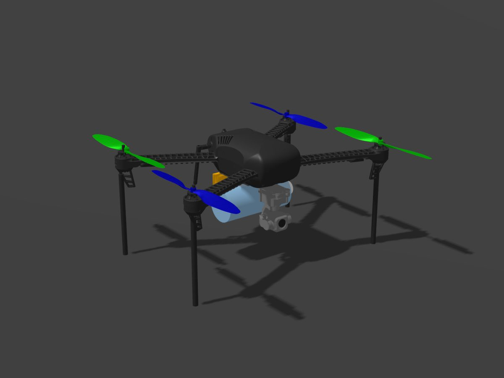
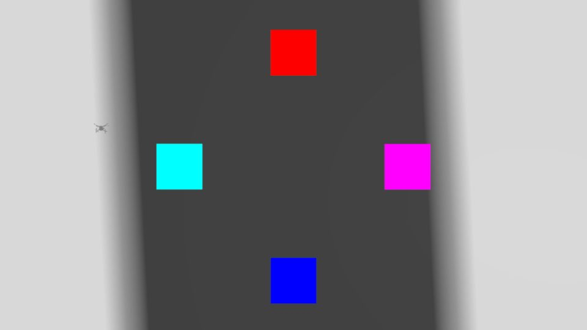
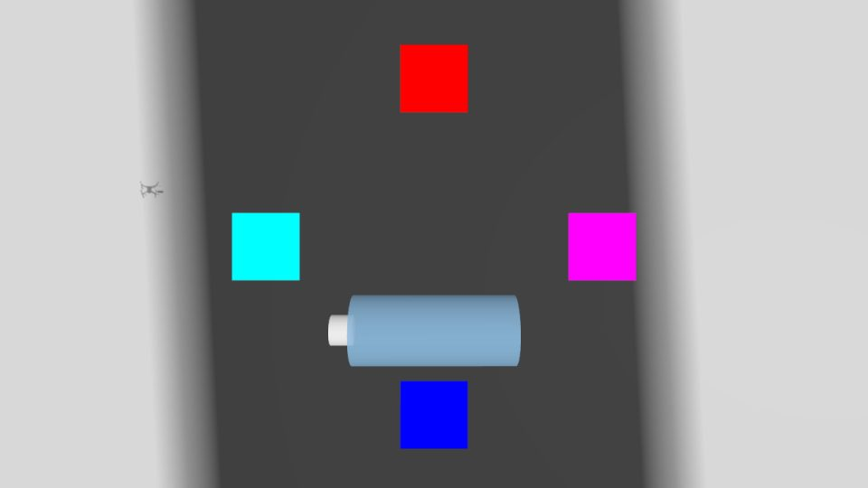
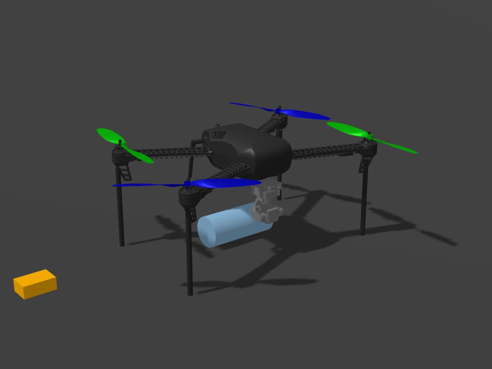
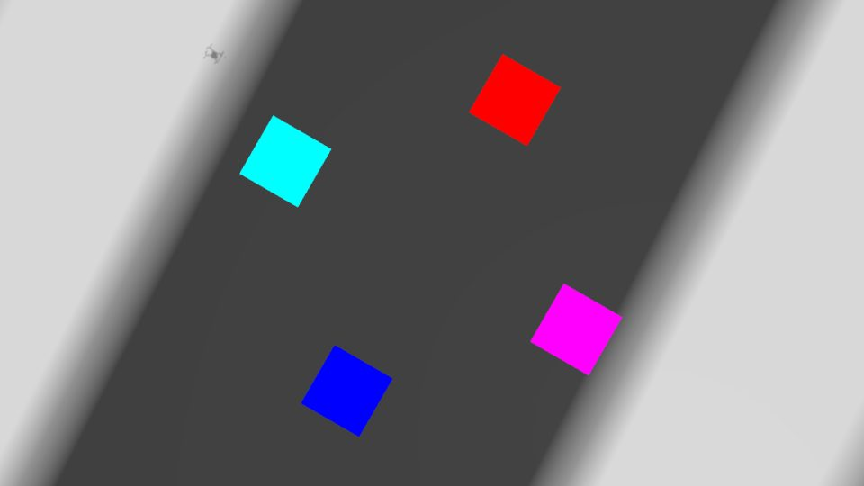
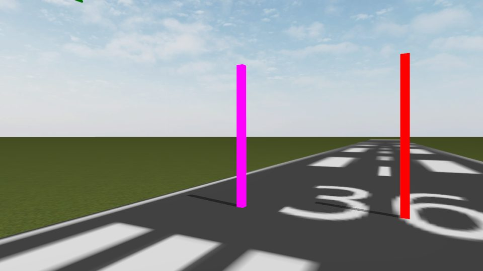

# sim_models: the simulated ASTRA drone

This package is the **drone** of the ASTRA Gazebo simulator. It holds:

| What | Where | In one sentence |
|---|---|---|
| The Gazebo model `iris_a8mini` | `models/iris_a8mini/` | The ArduPilot Iris quadcopter + a SIYI A8 mini gimbal camera + two droppable payloads. |
| Extra autopilot settings | `config/astra_sitl.parm` | Makes ArduCopter SITL behave like the team's Pixhawk (drop servos 11 and 13, no ArduPilot gimbal control, no geofence). |
| The drop mechanism | `scripts/payload_release.py` (`ros2 run sim_models payload_release`) | When ArduPilot opens servo 11 or 13, the matching payload falls in Gazebo. |
| The model generator | `scripts/generate_model_sdf.py` (`ros2 run sim_models generate_model_sdf`) | Turns `model.sdf.xacro` into a plain SDF file with the options you pick. |
| Tests | `test/` | Unit tests (no simulator) and a full flight acceptance test. |

The rest of the simulator (worlds, camera emulator, launch files, demo panel) lives in the other
packages of `ros2_ws/src/simulation/`; `simulation/README.md` explains how to start everything.

### What it looks like (pictures from the acceptance test)

| The drone on the ground | Camera straight down (pitch -90 deg) | Camera view of the bottle drop |
|---|---|---|
|  |  |  |
| Gimbal under the nose, 0.5 L bottle crosswise under the body, orange beacon behind it. | The test world's red square is 5 m north (the nose), magenta east, blue south, cyan west. The dark speck on the left is the drone's own shadow. | 0.25 s after `DO_SET_SERVO 11 1400`: the bottle falls past the camera. |
|  |  |  |
| After both drops and the landing: the bottle lies under the drone, the beacon bounced off it. | Still looking down, gimbal yaw +30 deg (camera turns LEFT): the picture turns 30 deg clockwise. | Looking ahead with yaw +30 deg: the pole that was straight ahead (red) moved to the right. |

---

## 1. Quick start (the short version)

```bash
# 1. build (in a Linux folder, not on /mnt/d)
cd ~/ros2_ws && colcon build --symlink-install --packages-select sim_models
source install/setup.bash          # also puts share/sim_models/models on GZ_SIM_RESOURCE_PATH

# 2. make the drone file for SITL instance 0 (2K photos)
ros2 run sim_models generate_model_sdf --instance 0 -o /tmp/iris_a8mini.sdf

# 3. with Gazebo running (GZ_SIM_RESOURCE_PATH must also contain ~/ardupilot_gazebo/models,
#    GZ_SIM_SYSTEM_PLUGIN_PATH must contain ~/ardupilot_gazebo/build), spawn it facing north:
ros2 run ros_gz_sim create -file /tmp/iris_a8mini.sdf -name iris -z 0.195 -Y 1.5708

# 4. start the drop mechanism
ros2 run sim_models payload_release

# 5. start the autopilot (from any empty folder)
~/sitl/arducopter --model JSON -I0 --home <lat>,<lon>,<alt>,0 \
  --defaults ~/sitl/copter.parm,~/sitl/gazebo-iris.parm,$(ros2 pkg prefix sim_models)/share/sim_models/config/astra_sitl.parm
```

Normally you do not type any of this: `simulation/scripts/demo.sh` (package `sim_bringup`) does it.

---

## 2. What the drone looks like inside (model tree)

```
iris_a8mini   (spawned as entity "iris"; canonical link = iris_with_standoffs::base_link)
|
+-- iris_with_standoffs            <include> from ardupilot_gazebo, unchanged
|     base_link (1.5 kg body + 4 legs) ... imu_link (imu_sensor) ... rotor_0..3 (rotor_N_joint)
|
+-- gimbal_base            fixed (gimbal_mount) to base_link, 7 cm forward, 6.7 cm down
|   +-- gimbal_yaw_link        joint gimbal_yaw    axis +Z     +-160 deg
|       +-- gimbal_roll_link       joint gimbal_roll   axis +X     +-30 deg
|           +-- gimbal_pitch_link      joint gimbal_pitch  axis 0 -1 0  -135..+45 deg  (camera head)
|               |-- sensor video_camera   1280x720 @ 25 Hz  -> /sim/camera/video/image
|               |-- sensor photo_camera   2560x1440 (zr10) or 3840x2160 (a8mini), TRIGGERED
|               +-- frames a8mini_camera_link (x = along the lens)
|                          a8mini_camera_optical_frame (z = along the lens; image frame_id)
|
+-- payload_person_latch   fixed (payload_person_latch_joint) under the body, x = 0
+-- payload_tent_latch     fixed (payload_tent_latch_joint) under the body, x = -6.5 cm
+-- payload_person (nested model)  link "body": 0.5 L water bottle, 0.5 kg, held by a DetachableJoint
+-- payload_tent   (nested model)  link "body": GPS beacon box, 0.12 kg, held by a DetachableJoint
|
+-- plugins: 8 x LiftDrag + 4 x ApplyJointForce + ArduPilotPlugin   (= iris_with_ardupilot)
             3 x JointPositionController (gimbal), JointStatePublisher (gimbal), OdometryPublisher
             2 x DetachableJoint (payloads), OdometryPublisher in each payload
```

Total gimbal mass 0.095 kg (a real A8 mini). Payloads hang between the legs, above the leg tips,
so the drone still stands on its legs and lands normally.

### Gimbal sign conventions (same as the SIYI SDK angles)

| Joint | Axis | Positive angle means | Limits (mechanical) |
|---|---|---|---|
| `gimbal_yaw` | +Z | camera turns **LEFT** (counter-clockwise seen from above) | -160 .. +160 deg |
| `gimbal_roll` | +X | **right side goes down** | -30 .. +30 deg |
| `gimbal_pitch` | 0 -1 0 | camera tilts **UP**; **-90 deg = straight down** | -135 .. +45 deg |

Gazebo cameras look along +X of their frame, so at 0/0/0 the camera looks out of the nose.
When pitched straight down, the top of the image points to the drone's nose.
Joint angles are relative to the drone body: keeping the picture level while the drone tilts
("stabilisation") is the job of whoever sends the targets (the `siyi_emulator` package).

---

## 3. Interface (everything other packages may use)

### 3.1 Gazebo topics (gz-transport; all start with `/sim/`)

| Topic | Type | Direction | Units / rate | Meaning |
|---|---|---|---|---|
| `/sim/gimbal/yaw/cmd_pos` | gz.msgs.Double | in | rad | yaw joint target (JointPositionController) |
| `/sim/gimbal/roll/cmd_pos` | gz.msgs.Double | in | rad | roll joint target |
| `/sim/gimbal/pitch/cmd_pos` | gz.msgs.Double | in | rad | pitch joint target (-pi/2 = down) |
| `/sim/gimbal/joint_states` | gz.msgs.Model | out | rad, rad/s, 50 Hz | measured `gimbal_yaw`, `gimbal_roll`, `gimbal_pitch` (axis1.position / velocity) |
| `/sim/drone/odometry` | gz.msgs.Odometry | out | m, 50 Hz | drone pose in the world frame (ENU: x East, y North, z Up), frame `world`, child `base_link` |
| `/sim/drone/odometry_with_covariance`, `/sim/drone/tf` | | out | | extra outputs of the same OdometryPublisher |
| `/sim/camera/video/image` | gz.msgs.Image | out | 1280x720 RGB, 25 Hz | live camera (renders only while someone subscribes) |
| `/sim/camera/video/camera_info` | gz.msgs.CameraInfo | out | | live camera intrinsics |
| `/sim/camera/photo/trigger` | gz.msgs.Boolean | in | | **one message = one photo** (the value is ignored) |
| `/sim/camera/photo/image` | gz.msgs.Image | out | 2560x1440 (zr10) / 3840x2160 (a8mini) RGB | the photo, published once per trigger |
| `/sim/camera/photo/camera_info` | gz.msgs.CameraInfo | out | | photo camera intrinsics |
| `/sim/payload/servo11` | gz.msgs.Double | out | microseconds, 1 kHz | SITL servo output 11 (person drop). Reads 1000 (closed) until the first DO_SET_SERVO; nothing is published before SITL connects. |
| `/sim/payload/servo13` | gz.msgs.Double | out | microseconds, 1 kHz | SITL servo output 13 (tent drop) |
| `/sim/payload/person/detach` | gz.msgs.Empty | in | | let the person payload fall |
| `/sim/payload/tent/detach` | gz.msgs.Empty | in | | let the tent payload fall |
| `/sim/payload/person/state`, `/sim/payload/tent/state` | gz.msgs.StringMsg | out | | `attached` / `detached` |
| `/sim/payload/person/odometry`, `/sim/payload/tent/odometry` | gz.msgs.Odometry | out | m, 10 Hz | payload position in the **world** frame (use this to see where it landed) |
| `/sim/payload/person/attach`, `/sim/payload/tent/attach` | gz.msgs.Empty | in | | DetachableJoint re-attach (not used: it would weld the payload wherever it is) |

Image and camera_info messages carry `frame_id = a8mini_camera_optical_frame` (ROS optical
convention: z along the lens, x right, y down).

### 3.2 ArduPilot (SITL) link

| Item | Value |
|---|---|
| JSON link | ArduPilotPlugin listens on UDP `127.0.0.1:9002 + 10 * I` for SITL instance `-I<I>` (xacro arg `fdm_port_in`), lock step on |
| Motors | SITL outputs 1..4 -> `iris_with_standoffs::rotor_0..3_joint` (unchanged from iris_with_ardupilot) |
| Payload servos | SITL outputs 11 and 13 -> `/sim/payload/servo11`, `/sim/payload/servo13` (raw microseconds) |
| Parameter file | `config/astra_sitl.parm`, loaded after `copter.parm` and `gazebo-iris.parm` |

### 3.3 payload_release node

`ros2 run sim_models payload_release` or `ros2 launch sim_models payload_release.launch.py`.
Gazebo topics are read and written directly with the gz-transport Python bindings
(`python3-gz-transport13`, `python3-gz-msgs10`, both installed with `gz-harmonic`); no bridge needed.

| ROS parameter | Default | Unit | Meaning |
|---|---|---|---|
| `payloads` | `['person', 'tent']` | | payload names to watch |
| `<name>.servo` | 11 (person), 13 (tent) | | SITL servo output number |
| `<name>.servo_topic` | `/sim/payload/servo<servo>` | | gz topic with the servo value |
| `<name>.detach_topic` | `/sim/payload/<name>/detach` | | gz topic that drops it |
| `<name>.odometry_topic` | `/sim/payload/<name>/odometry` | | gz topic with its world position |
| `<name>.state_topic` | `/sim/payload/<name>/state` | | gz topic with attached/detached |
| `open_threshold_us` | 1400.0 | us | servo value that means OPEN (flight code: 1400 open, 500 closed) |
| `min_open_time_s` | 0.0 | s | servo must stay open this long first (0 = drop at once) |
| `servo_sample_rate_hz` | 50.0 | Hz | the 1 kHz servo streams are throttled to this |
| `drone_odometry_topic` | `/sim/drone/odometry` | | drone position, logged at the release |
| `events_topic` | `/sim/payload/events` | | ROS topic for the events below |
| `landing_rest_speed` | 0.05 | m/s | slower than this = not moving |
| `landing_rest_time_s` | 1.0 | s | not moving this long after the drop = landed |
| `world_origin_lat`, `world_origin_lon`, `world_origin_alt` | NaN | deg, deg, m | the world's `<spherical_coordinates>`; when set, events also carry latitude/longitude |
| `detach_repeats` | 3 | | detach messages per release (0.2 s apart, until the joint says `detached`) |

| ROS topic | Type | QoS | Content |
|---|---|---|---|
| `/sim/payload/events` | std_msgs/String | reliable, transient local, depth 20 | one JSON object per event: `{"event": "released" / "detached" / "landed" / "attached", "payload": "person", "servo": 11, "pwm_us": 1400.0, "position_enu": [x, y, z], "position_lat": ..., "drone_enu": [...], "fall_time_s": ..., "fall_height_m": ..., "drift_m": ...}`. "attached" = a new payload is held again after a drop (Gazebo restarted while the node kept running); the node is then ready to drop it. |

**Release rule:** the first servo reading at or above `open_threshold_us` drops the payload,
exactly once. No reading, 0, 500 (closed), 1000 (SITL's start value) and anything else below the
threshold mean "closed". It does not wait for a "closed to open" change on purpose: a release node
started late may see 1400 (open) as its very first value and must still drop the payload.

### 3.4 Model generator (xacro arguments)

`ros2 run sim_models generate_model_sdf [options]` or plain `xacro model.sdf.xacro name:=value ...`

| xacro argument | Tool option | Default | Unit | Meaning |
|---|---|---|---|---|
| `camera_model` | `--camera-model` | `zr10` | | photo profile: `zr10` = 2560x1440 (last year's code targets the ZR10 2K profile), `a8mini` = 3840x2160 |
| `photo_width`, `photo_height` | `--photo-width/--photo-height` | 0 | px | 0 = from `camera_model`; give both to override |
| `video_width`, `video_height` | `--video-width/--video-height` | 1280, 720 | px | live video size |
| `video_fps` | `--video-fps` | 25 | Hz | live video rate |
| `hfov` | `--hfov` | 1.4137 | rad | horizontal field of view (81 deg, A8 mini), both cameras |
| `camera_noise_stddev` | `--noise` | 0.005 | 0..1 | Gaussian pixel noise |
| `fdm_port_in` | `--fdm-port-in` or `--instance I` | 9002 | UDP port | ArduPilotPlugin port = 9002 + 10 * I |
| `payloads` | `--no-payloads` | true | | include the two payloads |
| `payload_person_mass` | `--person-mass` | 0.5 | kg | water bottle (SUAS 2026 uses an 8 oz bottle: `--person-mass 0.25`) |
| `payload_tent_mass` | `--tent-mass` | 0.12 | kg | beacon |
| `gimbal_initial_pitch` | `--gimbal-initial-pitch` | 0.0 | rad | pitch target at spawn (-1.5708 = down) |

Other tool options: `-o FILE` (write to a file; default prints to the screen), `--update-default`
(rewrite `models/iris_a8mini/model.sdf`), `--xacro FILE` (use another xacro file).

---

## 4. How the payload drop works (follow one drop)

```
main_controller.py  --MAVROS /mavros/cmd/command-->  ArduCopter SITL: MAV_CMD_DO_SET_SERVO 11 1400
SITL servo output 11 = 1400 us  --JSON link-->  ArduPilotPlugin COMMAND control (channel 10)
    --> gz /sim/payload/servo11 = 1400.0  -->  payload_release: 1400 >= 1400 = OPEN
    --> gz /sim/payload/person/detach  -->  DetachableJoint removes the fixed joint
    --> the bottle falls (Gazebo physics)  -->  /sim/payload/person/state = "detached"
    --> /sim/payload/person/odometry shows it reaching the ground  -->  payload_release logs
        "LANDED at E .. N .." and publishes {"event": "landed", ...} on /sim/payload/events
```

---

## 5. The SITL parameter file (`config/astra_sitl.parm`)

| Parameter | Value | Why |
|---|---|---|
| `SERVO11_FUNCTION`, `SERVO13_FUNCTION` | 0 | Disabled = free for `MAV_CMD_DO_SET_SERVO` (otherwise "Channel is already in use"), like the team's Pixhawk |
| `SERVO11/13_MIN, _TRIM, _MAX` | 500, 500, 1900 | document the bench-verified travel (500 closed, 1400 open); DO_SET_SERVO ignores them |
| `MNT1_TYPE` | 0 | the A8 mini stabilises itself; ArduPilot must not drive the gimbal |
| `AUTO_OPTIONS` | 3 | arm and take off in AUTO without RC sticks |
| `FENCE_ENABLE` | 0 | no geofence (copter.parm's 150 m radius is smaller than the SUAS field mission) |
| `FS_GCS_ENABLE` | 0 | no failsafe when MAVROS/MAVProxy restarts |
| `PLND_ENABLED` | 0 | the stock Gazebo file turns on an IR-LOCK beacon the team's drone does not have |
| `BATT_FS_LOW_ACT`, `BATT_FS_CRT_ACT` | 0 | battery failsafes only warn |
| `SIM_SPEEDUP` | 1 | real time: the team's nodes use wall-clock sleeps |

Every line of the file is shorter than 90 characters on purpose: ArduPilot reads parameter files
in 100-byte pieces and would read the rest of a longer line as a new parameter line.
`test/test_astra_sitl_parm.py` re-creates that reader and checks the file.

Measured on ArduCopter 4.6.3 SITL: DO_SET_SERVO 1400 and 500 pass unclamped and are ACCEPTED.
Before the first DO_SET_SERVO a disabled output reports 0 in SERVO_OUTPUT_RAW and 1000 on the
Gazebo link (both "closed").

**Start-up note for scripts:** SITL resets the flight mode to STABILIZE when its start-up finishes
(the "ArduPilot Ready" message, about 1.5 s after the first heartbeat). Ask for GUIDED/AUTO after
that message, or check the mode again before arming.

---

## 6. Regenerating model.sdf

`models/iris_a8mini/model.sdf` is generated from `model.sdf.xacro` with the default arguments and
committed, so `model://iris_a8mini` works in world files without running xacro. After editing the
xacro:

```bash
cd ~/ros2_ws && colcon build --symlink-install --packages-select sim_models && source install/setup.bash
ros2 run sim_models generate_model_sdf --update-default      # rewrites model.sdf next to the xacro
colcon test --packages-select sim_models                     # test_model_generation checks it is up to date
```

With `--symlink-install` the installed xacro is a link to your source tree, so `--update-default`
writes into the source folder (copy it to the repo if your source tree is a copy).

---

## 7. Tests

| Test | Command | Needs |
|---|---|---|
| Unit tests (release logic, parameter file, model generation, node with a fake Gazebo) | `colcon test --packages-select sim_models && colcon test-result --verbose` | ROS 2 Humble, xacro; gz + ardupilot_gazebo for the `gz sdf -k` check |
| Full flight acceptance test | `bash $(ros2 pkg prefix sim_models)/share/sim_models/test/acceptance/run_acceptance.sh --instance 1` | Gazebo Harmonic, ArduCopter SITL, ardupilot_gazebo (simulation/setup/02_setup_ardupilot.sh), about 3 GB free memory |

The acceptance test (headless) starts Gazebo with `test/worlds/sim_models_test.sdf`, spawns the
model, starts `payload_release` and SITL `-I1`, then measures: parameter file loaded, arming after
the settling window, take-off to 15 m, 20 s hover (altitude, roll/pitch, drift), gimbal slew rate
and steady error, camera frames (pitch -90 = straight down, yaw +30 turns the picture), the
coloured targets appear where the gimbal geometry predicts, one photo per trigger at the profile
resolution, the real-time factor with both cameras busy, 30 m forward and back with the payloads
on, the two payload drops (servos 11 and 13) and landing. A fixed camera in the test world takes a
picture of the drone before take-off and after landing. Results: `results.json`, `summary.txt`,
`statustext.log` and pictures in the `--out` folder. Use `--camera-model a8mini` for the 4K photo
profile and `--tests flight,payload` (any subset of flight, cruise, gimbal, photo, rtf, payload)
for a shorter run.

### Latest results (2026-10-10, Ubuntu 22.04 + ROS 2 Humble + Gazebo Harmonic 8.15, ArduCopter 4.6.3 SITL, RTX 4060 laptop in WSL2)

| Check | Result |
|---|---|
| `xacro` -> SDF -> `gz sdf -k`, both camera profiles | valid (only the harmless `gz_frame_id` warning) |
| Parameter file loaded | 16 / 16 values of `astra_sitl.parm` read back from SITL |
| Arming | after about 40 s of SITL settling ("Arm: Gyros/Accels inconsistent" before that is normal) |
| Take-off to 15 m with both payloads, 20 s hover | altitude 15.00 m (std 0.003 m), max roll/pitch 0.13 deg, drift 0.01 m, hover throttle 39 % |
| Gimbal steps (pitch 0 -> -90, yaw 0 -> +30, roll 0 -> +15 -> 0, back) | slew 90.0 deg/s on every step, steady error 0.0 deg |
| Camera direction | pitch -90: optical axis 0.01 deg from straight down; the four coloured targets appear within 2 px of where the gimbal geometry predicts; yaw +30 moves the scene 433 px right (432.6 expected) |
| Photo trigger | 1 trigger -> exactly 1 photo: 2560 x 1440 (`zr10`) or 3840 x 2160 (`a8mini`), frame_id `a8mini_camera_optical_frame`, about 0.08 s |
| Real-time factor (lock step with SITL) | 1.04 with the 1280x720 video subscribed + one 2K photo per second; 0.85 with one 4K photo per second; video stays 25 fps in simulation time, 20/20 photos |
| 30 m forward and back with both payloads | about 7 s each way, top speed 7 m/s, max pitch 18 deg, height kept within 0.22 m |
| Payload drops (`DO_SET_SERVO 11 1400`, then 13) | ACK accepted; servo value in Gazebo 5 ms and "detached" 16 ms after the command; fell 15 m in 1.7 s and landed under the drone (resting at 0.0325 m = the bottle's radius); drone moved < 1 deg and 0.0 m |
| Landing | LAND, disarmed after about 30 s, back on its legs (base_link z = 0.195 m) |

---

## 8. Design notes (why it is built this way)

* **ament_cmake, not ament_python**: the package is mostly data (models, meshes, parameter file,
  test world). ament_cmake installs folders and scripts simply and lets us register an environment
  hook (`env-hooks/sim_models.dsv.in`) that adds `share/sim_models/models` to
  `GZ_SIM_RESOURCE_PATH` when the workspace is sourced. The Python helpers are still a normal
  module (`ament_python_install_package`).
* **The Iris is included, not copied** (`<include>model://iris_with_standoffs`), with the same
  LiftDrag, ApplyJointForce and ArduPilotPlugin blocks as `iris_with_ardupilot`, so the flight
  dynamics are exactly ArduPilot's tested ones. One change: the all-joints JointStatePublisher of
  iris_with_ardupilot (it published every physics step, 1000 times a second) is replaced by a
  50 Hz publisher of the three gimbal joints.
* **canonical_link is set to the Iris body**, because the gimbal and payload links are added at
  the top level and ArduPilotPlugin / OdometryPublisher report the canonical link's pose.
* **Gimbal control in velocity mode** (JointPositionController `use_velocity_commands`): every step
  the joint gets velocity = -(error)/dt, capped at `cmd_max` = 1.5708 rad/s. Result: a constant
  90 deg/s slew and essentially zero steady error, with no PID tuning. Joint efforts are finite
  (0.5 N m) and tiny inertias are inflated about 5 times for DART stability at 1 ms steps.
* **Payloads are nested models** held by DetachableJoint. DetachableJoint can only use a direct
  link of the model holding the plugin as its parent, so each payload hangs from its own small
  latch link (the release servo housing). ArduPilotPlugin COMMAND controls must name a real joint,
  so each servo channel names its latch's fixed joint. Each payload carries its own
  OdometryPublisher, because Gazebo's `/world/<world>/dynamic_pose/info` reports a nested model's
  pose relative to its parent model (the drone), not in the world.
* **payload_release talks gz-transport directly**: ArduPilotPlugin republishes each servo value on
  every physics step (1000 messages per second); a gz subscription throttle drops them to 50 Hz
  before Python sees them. A ros_gz bridge would push all of them through ROS.
* **Meshes**: `models/iris_a8mini/meshes/*.stl` are the A8 mini meshes of
  [siyi_ros2](https://github.com/mzahana/siyi_ros2) (MIT license, see `meshes/LICENSE`).

---

## 9. Troubleshooting

| Symptom | Cause / fix |
|---|---|
| `Unable to find uri[model://iris_with_standoffs]` | add `~/ardupilot_gazebo/models` to `GZ_SIM_RESOURCE_PATH` |
| `Failed to load system plugin [ArduPilotPlugin]` | add `~/ardupilot_gazebo/build` to `GZ_SIM_SYSTEM_PLUGIN_PATH` |
| SITL never gets data from Gazebo (no heartbeat on its MAVLink port, the drone never arms) | the model's `fdm_port_in` must be 9002 + 10 * (SITL `-I` number): regenerate with `--instance`. (SITL's own "Waiting for connection" only means nobody has connected to its MAVLink TCP port 5760 + 10 * I yet.) |
| GUIDED/AUTO asked for right after SITL starts, but the drone is in STABILIZE | SITL resets the mode when its start-up ends ("ArduPilot Ready"): ask again after that message |
| "Arm: Gyros inconsistent" for the first ~30 s | normal SITL settling; arming works afterwards |
| A payload does not fall | is `payload_release` running in the same `GZ_PARTITION`? Does `gz topic -e -t /sim/payload/servo11` show 1400 after the DO_SET_SERVO? Is the drone spawned from a model with payloads? |
| `payload_release` exits: "Gazebo Python bindings are missing" | `sudo apt install python3-gz-transport13 python3-gz-msgs10` |
| DO_SET_SERVO answers FAILED / "Channel 11 is already in use" | `astra_sitl.parm` was not loaded (check the `--defaults` list) |
| The camera image is black / nothing on `/sim/camera/video/image` | Gazebo needs a working GPU renderer (WSL2: `GALLIUM_DRIVER=d3d12`); cameras render only while subscribed |
| `gz sdf` warns `gz_frame_id ... not defined in SDF` | harmless: gz-sensors reads that element anyway (ardupilot's own Iris gives the same warning) |
| `libEGL warning: failed to open /dev/dri/renderD128: Permission denied ... falling back to kms_swrast` | harmless in WSL2 with `GALLIUM_DRIVER=d3d12`: `~/.gz/rendering/ogre2.log` still shows `GL_RENDERER = D3D12 (NVIDIA ...)`, i.e. the GPU renders |

---

## 10. Known limits

* **One drone with payloads per world.** DetachableJoint finds the payload models by name
  (`payload_person`, `payload_tent`); two such drones in one world would grab each other's payloads.
* **A dropped payload is still part of the drone model.** It falls and lands correctly, but it no
  longer collides with the drone (Gazebo turns off collisions inside one model), it disappears if
  the drone model is removed, and a re-spawned drone brings new payloads.
* **Hard landings sink in a little.** After a 15 m drop (17 m/s) DART lets a payload sink up to
  about 1 cm into the ground and pushes it back out within a few seconds; the "landed" event can
  report a height up to 1 cm low. East/North (what the drop score uses) are not affected.
* **Payload positions:** read `/sim/payload/<name>/odometry` or the ROS `/sim/payload/events`;
  `/world/<world>/dynamic_pose/info` gives the payload pose relative to the drone.
* The Iris body collision mesh of ardupilot_gazebo is not created by DART (log line
  "The geometry element of collision [base_collision] couldn't be created"); the drone stands and
  lands on its leg cylinders, as with ardupilot's own model.
* The real A8 mini's slew rate is not published by SIYI; 90 deg/s is ArduPilot's assumption.
* The default person-drop mass is the task's 0.5 L bottle (0.5 kg); SUAS 2026 uses an 8 oz bottle
  (`--person-mass 0.25`). The drone hovers at 39 % throttle with both payloads, so either is fine.
